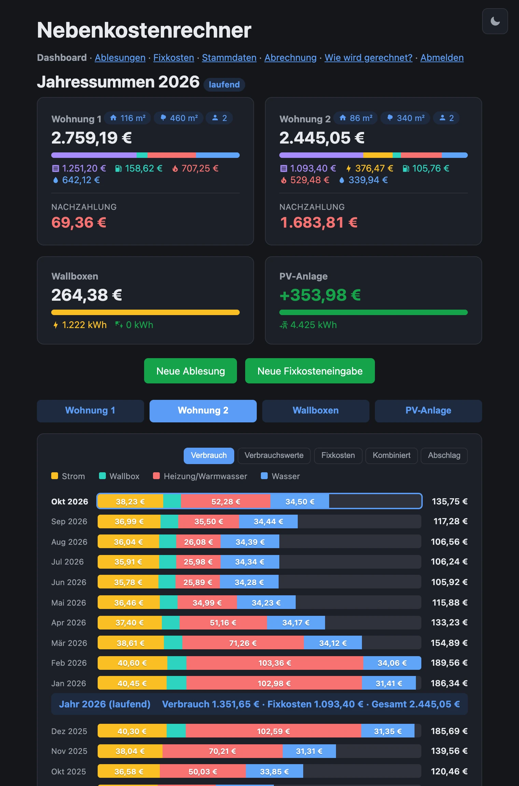

# Nebenkostenrechner

Web-App zur monatlichen Nebenkostenabrechnung für ein Zweifamilienhaus mit Wärmepumpe und PV-Anlage.
Sie berechnet Strom-, Heizung/Warmwasser- und Wasserkosten je Wohnung aus monatlich erfassten Zählerständen, dazu Fixkosten und Grundgebühren.
Nebenkostenabschläge werden gegengerechnet, so entsteht ein laufender Stand aus Guthaben oder Nachzahlung.
Vorausgesetzt werden Hauptzähler für die Gemeinschaft und Zwischenzähler für Wohnung 2, Wärmepumpe und Wallboxen.

<p align="center">
  
</p>

## Inhalt

- [Screenshots](#screenshots)
- [Funktionen](#funktionen)
- [Berechnung](#berechnung)
- [Tech-Stack](#tech-stack)
- [Installation](#installation)
  - [Docker](#docker)
  - [Anmeldung und Rollen](#anmeldung-und-rollen)
  - [Demo-Modus](#demo-modus)
  - [Home Assistant Add-on](#home-assistant-add-on)

## Screenshots

Alle Bilder stammen aus dem [Demo-Modus](#demo-modus), die Daten sind erfunden.

| Seite | Ansichten |
|---|---|
| Dashboard | [Verbrauch](docs/screenshots/dashboard.webp), [Fixkosten](docs/screenshots/dashboard-fixkosten.webp), [Kombiniert](docs/screenshots/dashboard-kombiniert.webp), [Wohnung 2](docs/screenshots/dashboard-wohnung2.webp), [PV-Anlage](docs/screenshots/dashboard-pv-anlage.webp), [dunkles Design](docs/screenshots/dashboard-dunkel.webp) |
| Ablesungen | [Liste](docs/screenshots/ablesungen.webp), [Detail](docs/screenshots/ablesung-detail.webp), [Ablesung korrigieren](docs/screenshots/ablesung-bearbeiten.webp) |
| Fixkosten | [Liste](docs/screenshots/fixkosten.webp), [Detail](docs/screenshots/fixkosten-detail.webp), [neue Eingabe](docs/screenshots/fixkosten-neu.webp) |
| Stammdaten | [Stammdaten](docs/screenshots/stammdaten.webp) |
| Abrechnung | [Jahresabrechnung](docs/screenshots/abrechnung.webp) |

## Funktionen

- **Ablesungen:** Zählerstände einmal im Monat in einem Wizard (Strom, Wärme, Wasser) erfassen. Auch ein Teilstand ist möglich und wird später vervollständigt. Warnungen bei negativem Verbrauch und bei Ausreißern.
- **Fixkosten:** Je Monat eine Eingabe mit Kostenpositionen (Grundsteuer, Versicherung, Abfall, Grundgebühren, Wartung u. a.), Preisen, Personenzahl, Nebenkostenabschlag und Miete.
- **Dashboard:** Jahreskarten je Wohnung, Karten für Wärmepumpe, Wallboxen und PV-Anlage, Monatsverlauf mit Saldo.
- **Jahresabrechnung:** Betriebskostenabrechnung je Wohnung und Jahr (auch für einen Teilzeitraum), druckbar als PDF mit Anlagen.
- **Stammdaten:** Wohnungsgrößen, Wohnungsstatus (Vermietung oder Eigennutzung), Namen und Anschriften, Heizungsgewichtung, Reihenfolge und Umlagefähigkeit der Kostenpositionen.
- **CSV:** Export und Import von Ablesungen und Fixkosten.
- **Rollen:** Vermieter:in, Mieter:in und nicht angemeldet mit einstellbaren Berechtigungen.
- **Demo-Modus:** Eigene Datenbank mit erfundenen Daten zum Ausprobieren.

## Berechnung

Alle Kosten werden bei jedem Aufruf live aus den Rohdaten berechnet und nicht gespeichert.
Die Formeln stehen in der App auf der Seite "Wie wird gerechnet?".

- **Strom:** Der Netzbezug wird nacheinander Wohnung 2, Wärmepumpe und Wallboxen zugeteilt, der Rest ist der Haushaltsstrom von Wohnung 1.
- **Heizung/Warmwasser:** Die Wärmepumpenkosten werden nach Wärmemenge und Wohnfläche auf beide Wohnungen verteilt.
- **Wasser:** Frisch- und Abwasser nach Zählern, das Warmwasser nach Personenzahl.
- **PV:** Die Einspeisevergütung kann Wohnung 1 gutgeschrieben werden.
- **Fixkosten:** Verteilung je Position nach Wohneinheit, Flurstück, Wohnungsgröße, Personenzahl oder fest auf eine Wohnung.
- **Saldo:** Abschläge minus Fixkosten und Verbrauch, fortlaufend seit Erfassungsbeginn.

Preise und Personenzahl werden je Monat bei den Fixkosten erfasst.
Die Zählerverschachtelung und die PV-Verrechnung zeigt [docs/pv-verrechnung.md](docs/pv-verrechnung.md).

## Tech-Stack

Go, SQLite (`modernc.org/sqlite`, `database/sql`) und serverseitig gerenderte `html/template` mit etwas Vanilla-JS.
Multi-Arch-Docker-Image (`linux/amd64`, `linux/arm64`, `linux/arm/v7`), die Datenbank liegt unter `/data`.

## Installation

### Docker

```bash
docker run -d \
  --name nebenkostenrechner \
  -p 8080:8080 \
  -v nebenkosten-data:/data \
  ghcr.io/larknafets/nebenkostenrechner:latest
```

Danach erreichbar unter `http://localhost:8080`, Health-Check unter `/healthz`.
Die Image-Tags folgen den [Releases](https://github.com/larknafets/nebenkostenrechner/releases).

> **Hinweis:** Der Container läuft als UID/GID 65532. Ein bestehendes Volume aus einer älteren Version muss einmalig angepasst werden:
> ```bash
> docker run --rm -v nebenkosten-data:/data busybox chown -R 65532:65532 /data
> ```

| Umgebungsvariable | Default | Beschreibung |
|---|---|---|
| `DB_PATH` | `/data/nebenkosten.db` | Pfad zur SQLite-Datenbankdatei |
| `LISTEN_ADDR` | `:8080` | Listen-Adresse des HTTP-Servers |
| `VERMIETER_PASSWORD` | *(leer)* | Kennwort der Vermieter:innen. Leer = alles offen, alle sind Vermieter:innen. |
| `MIETER_PASSWORD` | *(leer)* | Kennwort der Mieter:innen. Wirkt nur zusammen mit `VERMIETER_PASSWORD`. |

### Anmeldung und Rollen

"Anmelden" öffnet ein Overlay mit der Wahl der Rolle (**Mieter:in**, **Vermieter:in**, **Demo**) und einem Kennwort.
Die Vermieter:innen dürfen alles, was nicht angemeldete Personen und Mieter:innen sehen und tun dürfen, stellen sie auf der Stammdaten-Seite unter "Berechtigungen" ein.
Die App gehört nicht direkt ins Internet, sondern hinter Home Assistant Ingress oder ins Heimnetz.

### Demo-Modus

Die Rolle **Demo** braucht kein Kennwort und arbeitet in einer eigenen Datenbank (`demo.db` neben `DB_PATH`) mit 39 Monaten erfundener Daten.
Jeder Demo-Login setzt sie zurück, die echten Daten bleiben unberührt.

### Home Assistant Add-on

Das Add-on mit Ingress-Integration steht im Repository [`larknafets/ha-addons`](https://github.com/larknafets/ha-addons).
Es gibt eine Release-Variante (**Nebenkosten**) und eine **Nebenkosten (Nightly)** mit dem täglichen Stand von `main`, mit eigenen Daten.
